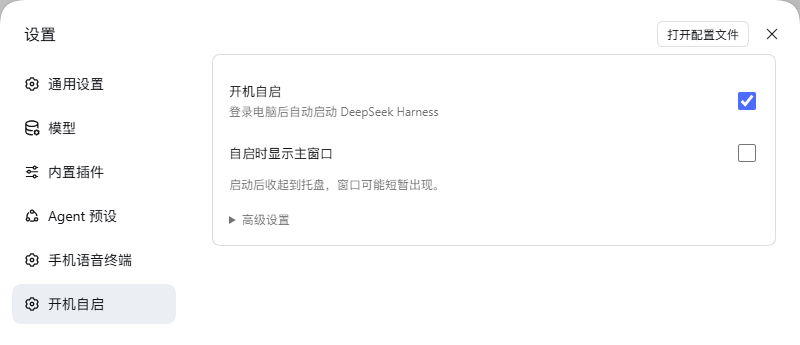
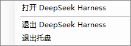

# DSH 开机自启

登录设备后自动启动 DeepSeek Harness，可选择桌面客户端或本机 Web 服务。当前版本 **v0.3.0 跨平台测试版**。

## 支持范围

| 系统 | 桌面客户端 | 本机 Web 服务 | 自启时不弹窗口 |
| --- | --- | --- | --- |
| Windows | 用户登录启动，支持托盘 | 用户登录启动 | 桌面收起到托盘；Web 不打开浏览器 |
| macOS | 用户登录启动（.app） | 用户登录启动 | 桌面请求系统隐藏启动；Web 不打开浏览器 |
| Linux | 图形桌面登录启动（XDG） | 图形桌面登录启动（XDG） | Web 不打开浏览器；桌面客户端仅正常显示 |

Windows 已完成本机测试。macOS、Linux 已实现适配并通过模拟测试，尚未完成对应系统的真实登录验收。Linux 需要支持 XDG Autostart 的桌面环境。

这里的“开机自启”指**用户登录后启动**；无人登录的服务器、systemd 系统服务、Windows 服务暂不包含在内。

## 下载与安装

到 [Releases](https://github.com/Nickszy/dsh-autostart-manager/releases/tag/v0.3.0) 下载 `dsh-autostart-manager-0.3.0.tgz`。这是 DSH 插件包，无需运行 EXE 安装器。

把下载文件的完整路径告诉 DSH 插件管理助手：

> 请用插件管理器安装这个本地插件包：/完整路径/dsh-autostart-manager-0.3.0.tgz

使用本地 `file:` 引用安装；也可下载源码后使用 `link:`。安装或升级后重启运行 DSH 的客户端或 Web 宿主，并刷新设置页。

## 使用

打开「设置 → 开机自启」：

- 选择“桌面客户端”或“Web 服务”。
- 桌面模式可配置客户端位置；Web 模式先在高级设置填好启动信息。
- 打开“开机自启”，下次登录时生效。
- 修改启动方式或窗口选项后，点击“保存设置”。

通过浏览器配置远端 DSH 时，修改的是 **DSH 服务所在设备**，不会设置浏览器所在电脑的自启。

### 桌面客户端

Windows 关闭“自启时显示主窗口”后，启动窗口会收起到托盘，可能短暂出现。双击托盘图标或选择“打开 DeepSeek Harness”恢复窗口；“退出 DeepSeek Harness”发送正常关闭请求；“退出托盘”恢复助手曾隐藏的窗口。手动打开的客户端保留当前窗口状态。

macOS 选择 `.app` 应用；关闭窗口选项后通过系统 `open -g -j` 请求隐藏启动，实际效果取决于应用自身行为，不提供本插件托盘。

Linux 选择可执行客户端文件，例如已赋予执行权限的 AppImage。本版按正常窗口启动，不提供通用隐藏或托盘。

### Web 服务

高级设置需要填写：启动程序、启动参数（JSON 字符串数组）、工作目录、本机访问地址、Node.js 路径。

推荐使用实际的 Node.js 可执行文件启动 DSH CLI 脚本。例如：

```text
启动程序：/实际安装位置/node
启动参数：["/实际安装位置/dsh-cli.js", "--profile", "web", "--port", "8080"]
工作目录：/你的工作目录
本机访问地址：http://127.0.0.1:8080/
Node.js 路径：/实际安装位置/node
```

示例路径需替换成机器上的真实路径；Windows 使用 `node.exe`，JSON 中的反斜杠需写成 `\\`。不支持把 `.cmd`、Shell 命令或整行命令粘贴到启动程序中。

保留自己的 `--profile` 参数，使用固定端口，并让本机访问地址与启动参数一致。`desktop` 配置属于桌面客户端，不能作为 npm CLI 的 Web 配置使用。

关闭“自启时打开浏览器”会加入 `--no-open`；开启则由 DSH 打开自己的登录地址。助手不保存启动输出里的登录凭据。对应地址已有监听时不会再启动一个服务；若需要打开浏览器，会访问已配置的基础地址，登录依赖原有浏览器会话。

## 效果预览

以下是 **v0.2.0 Windows 版**的真实截图。v0.3.0 增加了启动方式和 Web 高级设置，截图将在完成新版实际界面验收后更新。



Windows 桌面模式的托盘菜单：



## 行为与限制

- 修改配置、刷新页面、插件加载或手动启动均不会主动解除系统禁用；只有在插件内主动开启自启才恢复。
- 停用只移除本插件的登录启动项，不结束当前 DSH 进程。
- Windows 外部窗口隐藏可能闪窗，不拦截以后手动关闭窗口；助手被强制终止时无法恢复已隐藏窗口。
- macOS 使用 LaunchAgent，Linux 使用 XDG `.desktop`；均在下次登录生效，不会保存设置后立即启动第二个 DSH。
- 配置及启动助手位于 `$DSH_HOME/autostart`（默认 `~/.dsh/autostart`）。Web 助手保存工作目录、程序搜索路径和配置环境，并以互斥锁避免重复启动；日志超过 256 KiB 轮转。
- 卸载前先关闭开机自启，Windows 还需退出托盘。卸载插件不会自动删除独立启动资产。

## 开发与验证

需要 Node.js 22+，无第三方运行时依赖、无转译步骤。此包直接提供宿主模块及客户端模块；源码更新后需重新加载宿主或重启 DSH，客户端页面需刷新。

```sh
npm run check
npm test
```

测试包括三平台配置/启动项生成、系统禁用状态保留、旧配置迁移、地址与参数校验，以及真实 Node 子进程的 Web 静默/展示参数、工作目录、环境恢复、并发去重、已占用地址和日志凭据隔离。macOS/Linux 原生登录启动仍需实机验证。

API：`POST /api/dsh-autostart-manager`，JSON `{ "endpoint": "state", "payload": {} }`。支持 `state`、`configure`、`enable`、`disable`、`launch-now`；保留旧 `setmode` 与 `set-exe` 接口。
